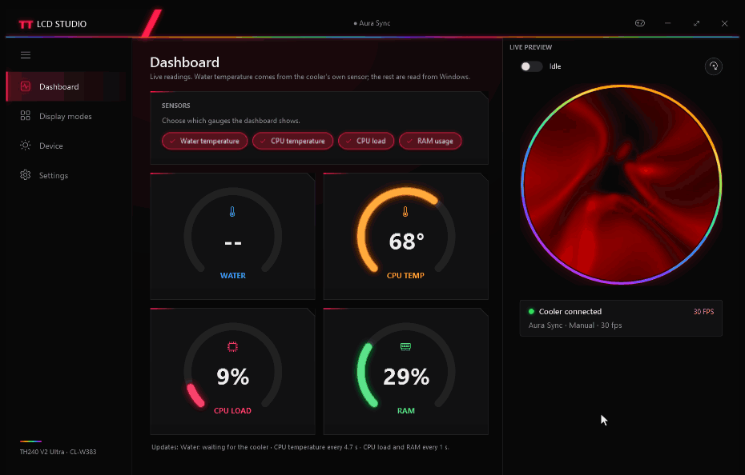
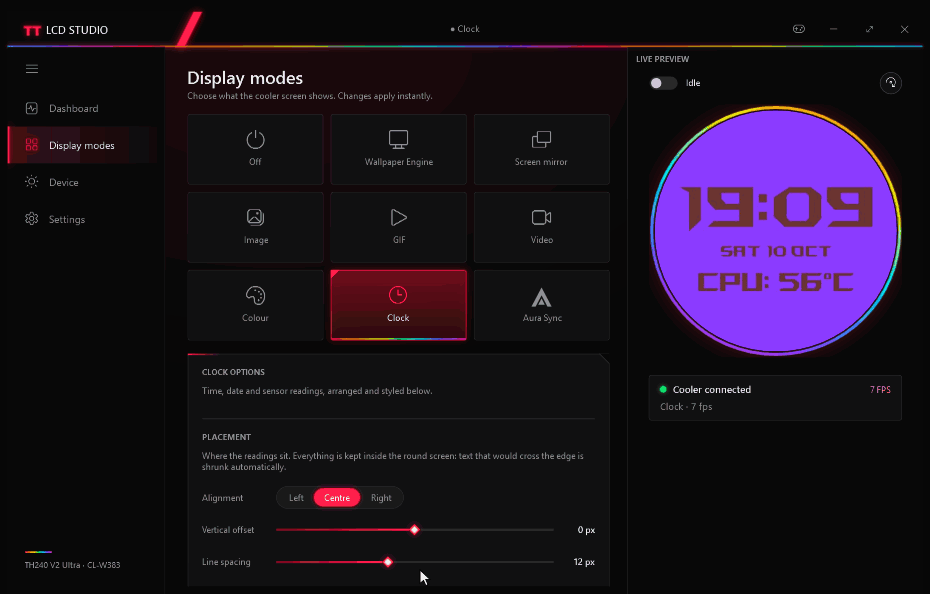
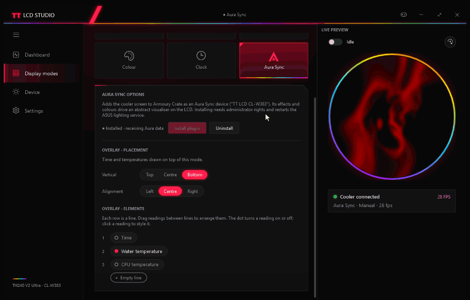
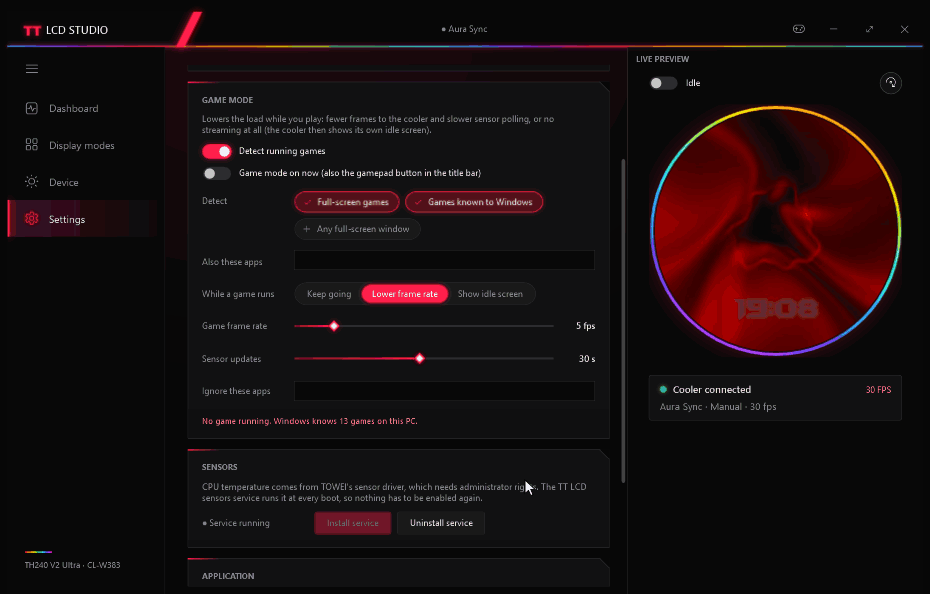
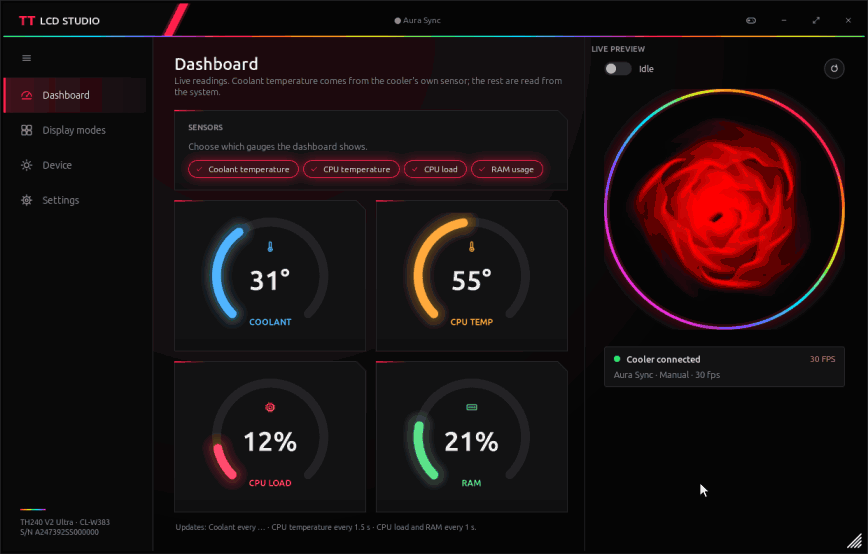

<div align="center">

# TT LCD Studio

**Open replacement software for the round 2.1" LCD on the Thermaltake TH240 V2 Ultra ARGB (CL-W383) AIO cooler.**

No TT RGB Plus, no frameworks to install, no telemetry. One small Windows app built by reverse engineering the cooler's
USB protocol.

[](https://github.com/anatolijphp/Thermaltake-TH240-V2-ULTRA-LCD/actions/workflows/build.yml)
[](https://github.com/anatolijphp/Thermaltake-TH240-V2-ULTRA-LCD/releases)

-512bd4)



</div>

## Highlights

|  |  |
|---|---|
| 🖥️ **Nine display modes** | Wallpaper Engine (via a bundled 480×480 virtual monitor), screen mirror, image, GIF, video, colour, clock, Aura Sync, off |
| 🕒 **Clock and sensor face** | Time, date, coolant temperature from the cooler's own sensor, CPU temperature and load. Drag readings into lines, style each one |
| 🌈 **Aura Sync** | Shows up in ASUS Armoury Crate as a device; its effects drive a MilkDrop-style visualiser on the LCD |
| 📊 **Dashboard** | Live gauges for coolant, CPU temperature, CPU load and RAM |
| 🎮 **Game mode** | Detects games and lowers the frame rate and sensor polling, or hands the screen back to the cooler's idle picture |
| 🖼️ **Idle picture** | Crop, compress, upload and verify the picture the cooler shows on its own |
| 🔄 **One rotation setting** | Turns the live picture and the cooler's own idle and boot screens together |
| 🪶 **Light** | Under 1 MB, no runtimes to install: it uses only what ships with Windows |

## Screens

### Pick a mode, see it live

One click switches what the cooler shows: your **Wallpaper Engine** wallpaper (on a virtual 480×480 monitor),
**Aura Sync** effects from Armoury Crate, a looping **GIF**, and more. The preview on the right is exactly what the
cooler shows, rotated the way the pump is mounted.



### Style every reading

Any mode can carry an overlay of time and temperatures, and the Clock mode is made of them. Arrange readings into lines
by drag and drop, then style each one on its own: font, size, effect (shadow, outline, neon glow), colour, label beside
or above, °C/°F and colour-by-value. Everything is kept inside the round screen automatically.



### Game mode

Streaming 30 frames a second to the cooler costs a little CPU and USB time. Game mode gives that back while you play:

- **Detects games by itself**, using only what Windows already knows:
  - full-screen Direct3D games
  - games in the Xbox Game Bar list, matched against running processes
  - optionally, any window that covers its whole monitor (borderless games)
  - your own lists of apps to include or ignore
- **While a game runs**, pick one:
  - **Lower frame rate**: keep the screen alive at a frame rate you choose (default 5 fps)
  - **Show idle screen**: stop streaming completely, so the cooler shows its own idle picture
  - **Keep going**: change nothing
- **Slower sensor polling** while gaming (default every 10 s) for the coolant and CPU temperature.
- **Force it on** any time with the gamepad button in the title bar or the switch in Settings, for example for a game
  that isn't detected. The title bar shows when game mode is on.



## Install

1. Download **`TTLcdStudio-Setup.exe`** from the [latest release](https://github.com/anatolijphp/Thermaltake-TH240-V2-ULTRA-LCD/releases)
   (or the newest run on the [Actions](https://github.com/anatolijphp/Thermaltake-TH240-V2-ULTRA-LCD/actions) tab).
2. Run it. It installs per user to `%LOCALAPPDATA%\Programs\TT LCD Studio`, **no administrator rights needed**, and
   can add a Start menu shortcut and start with Windows.
3. Optional parts ask for administrator rights when you pick them:
   - **CPU temperature service** (reads the CPU temperature through TOWEI's sensor driver, which must be installed)
   - **Armoury Crate plugin** (Aura Sync)
   - **Virtual display driver** (for Wallpaper Engine)

Prefer no installer? Grab **`TTLcdStudio-portable.zip`** instead and run `TTLcdStudio.exe` from anywhere.

<details>
<summary>Silent install and uninstall</summary>

```
TTLcdStudio-Setup.exe /S [/D=<folder>]
Uninstall.exe /uninstall /S [/all]
```

Uninstalling keeps your settings in `%APPDATA%\ttlcd`. The shared Aura plugin and display driver are removed only with
`/all` or when you confirm it.
</details>

> **Close TT RGB Plus first.** Only one program can drive the LCD at a time.

### Ubuntu / Linux

TT LCD Studio runs on Ubuntu too, with the same look: a native GTK window over the same engine and settings.



```
sudo apt install ./ttlcd_1.3.1_all.deb ./ttlcd-studio_1.3.1_all.deb   # from the release
ttlcd-studio                                                          # or "TT LCD Studio" in the app menu
```

`ttlcd-studio` is a separate package (it depends on `ttlcd` and installs it too if it's missing) and bundles
GTK# 3 itself, since Debian dropped `libgtk3.0-cil` from its archives in 2023 and it's gone from Ubuntu entirely
from 25.10 onward. Only the native GTK3/GLib/Pango/Atk/Cairo libraries are needed from the system - those are
still part of any current desktop - so both packages install cleanly on 26.04 too.

- **Everything Linux can do, in the window:**
  - dashboard
  - Image, GIF, Colour, Clock, Aura Sync and Off modes with the overlay
  - drag-and-drop lines and per-reading styles
  - device and streaming settings
  - the idle picture
  - tray icon (AppIndicator) and start with the desktop session
- **CPU temperature:** read straight from the kernel's sensor driver (k10temp, zenpower, coretemp); nothing to install.
- **Aura Sync on Linux:** needs [armory-crate](https://github.com/anatolijphp/armory-crate-alternative-ubuntu), a separate Linux replacement for Armoury Crate.
  ttlcd installs no plugin or service of its own for this; follow armory-crate's instructions to set it up for
  ttlcd. Until armory-crate is installed, the Aura Sync mode is greyed out. It becomes available on its own once
  armory-crate is there, without restarting Studio.
- **Windows-only for now:** Wallpaper Engine, screen mirroring, video and automatic game detection.
  Game mode can still be switched on by hand.
- **Cooler access without root:** the package adds a udev rule (replug the cooler or reboot once after installing).

<details>
<summary>Without the window: the command line and a background service</summary>

```
systemctl --user enable --now ttlcd       # drive the screen, also after every login
ttlcd set Mode Clock                      # or Image / Gif / Color / Aura / Off; the service picks it up
ttlcd set GifPath ~/Pictures/loop.gif
ttlcd config                              # all settings (~/.config/ttlcd/config.xml)
```

Studio stops this service while its window is open, so the two never drive the cooler at the same time. Other
distributions: unpack `ttlcd-<version>-linux.tar.gz` to `/` and install Mono and libgdiplus (and the native GTK3
libraries from "Everything Linux can do" above, for the window).
</details>

## Build from source

**Windows:** `build.cmd` uses the .NET Framework 4.8 C# compiler that ships with it. No SDK,
no NuGet. **Linux:** `./build.sh` with Mono (`sudo apt install mono-devel`) and `curl`; it compiles the same
sources and fetches GTK# 3 itself (pinned, checksummed, see `build.sh`) rather than needing it preinstalled.

```
git clone https://github.com/anatolijphp/Thermaltake-TH240-V2-ULTRA-LCD.git
cd Thermaltake-TH240-V2-ULTRA-LCD
build.cmd
```

Sources and build output are kept apart. Everything built lands in `build\<os>\` (only Windows so far):

| `build\windows\` | What |
|---|---|
| `app\TTLcdStudio.exe` | The app (WPF + tray). `app\` has the installed layout and runs as is |
| `app\ttlcd.exe` | Command-line tool; also installs the driver, the Aura plugin and the sensor service |
| `app\TTLcdAura.dll` | Armoury Crate / Aura Sync plugin |
| `app\driver\`, `app\firmware\` | Virtual display driver; LCD firmware and rescue tools |
| `TTLcdStudio-Setup.exe` | The installer |

| `build/linux/` | What |
|---|---|
| `ttlcd_<version>_all.deb` | Debian/Ubuntu package: `ttlcd` (CLI + service), udev rule, systemd user service |
| `ttlcd-studio_<version>_all.deb` | Debian/Ubuntu package: `ttlcd-studio` (GTK window, bundles GTK# 3), menu entry; depends on and installs `ttlcd` |
| `ttlcd-<version>-linux.tar.gz` | The same files for other distributions |
| `pkg/`, `pkg-studio/` | The installed layouts |

Every push runs [GitHub Actions](.github/workflows/build.yml) on Windows and Ubuntu: build, firmware checksum check, a
silent install and uninstall smoke test, and an install of the `.deb` into a clean Ubuntu container that renders
frames. Tags `v*` publish a release with the files for both.

## Command line

```
ttlcd info                  serial, type, rotation
ttlcd temp                  coolant temperature from the cooler's sensor
ttlcd image <file>          show a picture
ttlcd stream [-m N]         mirror a monitor
ttlcd service install       CPU temperature service (admin, one time)
ttlcd display install       virtual 480×480 monitor for Wallpaper Engine (admin)
ttlcd aura install          Armoury Crate / Aura Sync plugin (admin)
ttlcd run                   drive the screen from the settings (the Linux service runs this)
ttlcd set <name> <value>    change a setting, e.g. ttlcd set Mode Clock
ttlcd render <out.jpg>      render one frame of the current mode, no cooler needed
```

Run `ttlcd` without arguments for the full list.

## How it works

The LCD has its own controller (Nuvoton W55FA93) behind a USB HID interface: one endpoint for control commands
(brightness, rotation, sensor queries) and one for 480×480 JPEG frames. Studio renders each frame (mode, overlay,
rotation), encodes it and streams it at up to 30 fps. The protocol is documented in [`docs/protocol.md`](docs/protocol.md).

| Path | What |
|---|---|
| [`src/`](src) | Engine, protocol, CLI and the shared Studio logic; the WPF window (Windows) |
| [`src/gtk/`](src/gtk) | The GTK window (Linux) |
| [`aura/`](aura) | Armoury Crate HAL plugin |
| [`installer/`](installer) | Installer and uninstaller |
| [`driver/`](driver) | Bundled MttVDD virtual display driver (signed, MIT) |
| [`firmware/`](firmware) | LCD controller firmware and the burn guide |
| [`rescue/`](rescue) | Firmware tool sources |
| [`docs/`](docs) | Protocol notes and README media |
| [`re/scripts/`](re/scripts) | Ghidra scripts used for the reverse engineering |
| [`tools-src/`](tools-src) | Icon generator |

<details>
<summary>Recording the README GIFs</summary>

`TTLcdStudio.exe --record docs\media\<scene>.gif <dashboard|modes|style|game>` plays a scripted scene in an
off-screen window and saves it as a GIF ([`src/Record.cs`](src/Record.cs)). Close the running Studio first; the scenes
change settings like a user would, so restore `%APPDATA%\ttlcd\config.xml` afterwards. For the GIF mode, set
`TTLCD_REC_GIF` to an animated GIF to play.

On Linux, `ttlcd-studio --record docs/media/ubuntu.gif tour 0.7` records the Ubuntu tour in the real window
([`src/gtk/Record.cs`](src/gtk/Record.cs), the same GIF writer). Point `XDG_CONFIG_HOME` at a copy of the config
so the mode changes don't touch your own settings.
</details>

## ⚠️ Warnings

- On the **original Thermaltake firmware**, never use the on-device storage uploads (protocol commands `0x0A`/`0x0B`).
  One upload erased the LCD controller's flash during development. The app refuses them on that firmware.
- If the LCD is bricked (it no longer shows up over USB), [`firmware/README.md`](firmware/README.md) explains how to
  restore it. That needs the pump head opened.
- Pump and fans run on separate electronics and keep working whatever happens to the LCD.

Not affiliated with Thermaltake, ASUS, TCOMAS or Nuvoton. Use at your own risk.
