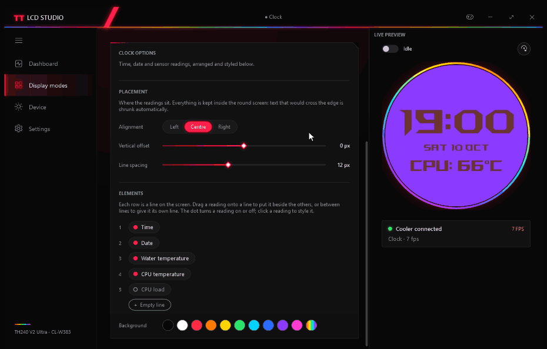

<div align="center">

# TT LCD Studio

**Open replacement software for the round 2.1" LCD on the Thermaltake TH240 V2 Ultra ARGB (CL-W383) AIO cooler.**

No TT RGB Plus, no frameworks to install, no telemetry. One small Windows app built by reverse engineering the cooler's
USB protocol.

[](https://github.com/anatolijphp/Thermaltake-TH240-V2-ULTRA-LCD/actions/workflows/build.yml)
[](https://github.com/anatolijphp/Thermaltake-TH240-V2-ULTRA-LCD/releases)

-512bd4)


</div>

## Highlights

|  |  |
|---|---|
| 🖥️ **Nine display modes** | Wallpaper Engine (via a bundled 480×480 virtual monitor), screen mirror, image, GIF, video, colour, clock, Aura Sync, off |
| 🕒 **Clock and sensor face** | Time, date, water temperature from the cooler's own sensor, CPU temperature and load. Drag readings into lines, style each one |
| 🌈 **Aura Sync** | Shows up in ASUS Armoury Crate as a device; its effects drive a MilkDrop-style visualiser on the LCD |
| 📊 **Dashboard** | Live gauges for water, CPU temperature, CPU load and RAM |
| 🎮 **Game mode** | Detects games and lowers the frame rate and sensor polling, or hands the screen back to the cooler's idle picture |
| 🖼️ **Idle picture** | Crop, compress, upload and verify the picture the cooler shows on its own |
| 🔄 **One rotation setting** | Turns the live picture and the cooler's own idle and boot screens together |
| 🪶 **Light** | Under 1 MB, no runtimes to install: it uses only what ships with Windows |

## Screens

### Pick a mode, see it live

The preview on the right is exactly what the cooler shows, rotated the way the pump is mounted.


### Style every reading

Arrange readings into lines by drag and drop. Each reading has its own font, size, effect, colour, label (beside or
above), units and colour-by-value. Everything is kept inside the round screen automatically.



## Install

1. Download **`TTLcdStudio-Setup.exe`** from the [latest release](https://github.com/anatolijphp/Thermaltake-TH240-V2-ULTRA-LCD/releases)
   (or the newest run on the [Actions](https://github.com/anatolijphp/Thermaltake-TH240-V2-ULTRA-LCD/actions) tab).
2. Run it. It installs per user to `%LOCALAPPDATA%\Programs\TT LCD Studio`, **no administrator rights needed**, and
   can add a Start menu shortcut and start with Windows.
3. Optional parts ask for administrator rights when you pick them:
   - **CPU temperature service** (reads the CPU temperature through TOWEI's sensor driver, which must be installed)
   - **Armoury Crate plugin** (Aura Sync)
   - **Virtual display driver** (for Wallpaper Engine)

Prefer no installer? Grab **`TTLcdStudio-portable.zip`** instead and run `TTLcdStudio.exe` from anywhere.

<details>
<summary>Silent install and uninstall</summary>

```
TTLcdStudio-Setup.exe /S [/D=<folder>]
Uninstall.exe /uninstall /S [/all]
```

Uninstalling keeps your settings in `%APPDATA%\ttlcd`. The shared Aura plugin and display driver are removed only with
`/all` or when you confirm it.
</details>

> **Close TT RGB Plus first.** Only one program can drive the LCD at a time.

## Build from source

All you need is Windows: `build.cmd` uses the .NET Framework 4.8 C# compiler that ships with it. No SDK, no NuGet.

```
git clone https://github.com/anatolijphp/Thermaltake-TH240-V2-ULTRA-LCD.git
cd Thermaltake-TH240-V2-ULTRA-LCD
build.cmd
```

Sources and build output are kept apart. Everything built lands in `build\<os>\` (only Windows so far):

| `build\windows\` | What |
|---|---|
| `app\TTLcdStudio.exe` | The app (WPF + tray). `app\` has the installed layout and runs as is |
| `app\ttlcd.exe` | Command-line tool; also installs the driver, the Aura plugin and the sensor service |
| `app\TTLcdAura.dll` | Armoury Crate / Aura Sync plugin |
| `app\driver\`, `app\firmware\` | Virtual display driver; LCD firmware and rescue tools |
| `TTLcdStudio-Setup.exe` | The installer |

Every push runs [GitHub Actions](.github/workflows/build.yml): build, firmware checksum check, a silent install and
uninstall smoke test, then the installer and portable zip as artifacts. Tags `v*` publish a release.

## Command line

```
ttlcd info                  serial, type, rotation
ttlcd temp                  water temperature from the cooler's sensor
ttlcd image <file>          show a picture
ttlcd stream [-m N]         mirror a monitor
ttlcd service install       CPU temperature service (admin, one time)
ttlcd display install       virtual 480×480 monitor for Wallpaper Engine (admin)
ttlcd aura install          Armoury Crate / Aura Sync plugin (admin)
```

Run `ttlcd` without arguments for the full list.

## How it works

The LCD has its own controller (Nuvoton W55FA93) behind a USB HID interface: one endpoint for control commands
(brightness, rotation, sensor queries) and one for 480×480 JPEG frames. Studio renders each frame (mode, overlay,
rotation), encodes it and streams it at up to 30 fps. The protocol is documented in [`docs/protocol.md`](docs/protocol.md).

| Path | What |
|---|---|
| [`src/`](src) | App, CLI and protocol (C# 5, WPF) |
| [`aura/`](aura) | Armoury Crate HAL plugin |
| [`installer/`](installer) | Installer and uninstaller |
| [`driver/`](driver) | Bundled MttVDD virtual display driver (signed, MIT) |
| [`firmware/`](firmware) | LCD controller firmware and the burn guide |
| [`rescue/`](rescue) | Firmware tool sources |
| [`docs/`](docs) | Protocol notes and README media |
| [`re/scripts/`](re/scripts) | Ghidra scripts used for the reverse engineering |
| [`tools-src/`](tools-src) | Icon generator |

<details>
<summary>Recording the README GIFs</summary>

`TTLcdStudio.exe --record docs\media\<scene>.gif <modes|dashboard|clock>` plays a scripted scene in an off-screen
window and saves it as a GIF ([`src/Record.cs`](src/Record.cs)). Close the running Studio first; the scenes change the
mode like a user would, so restore `%APPDATA%\ttlcd\config.xml` afterwards.
</details>

## ⚠️ Warnings

- On the **original Thermaltake firmware**, never use the on-device storage uploads (protocol commands `0x0A`/`0x0B`).
  One upload erased the LCD controller's flash during development. The app refuses them on that firmware.
- If the LCD is bricked (it no longer shows up over USB), [`firmware/README.md`](firmware/README.md) explains how to
  restore it. That needs the pump head opened.
- Pump and fans run on separate electronics and keep working whatever happens to the LCD.

Not affiliated with Thermaltake, ASUS, TCOMAS or Nuvoton. Use at your own risk.
